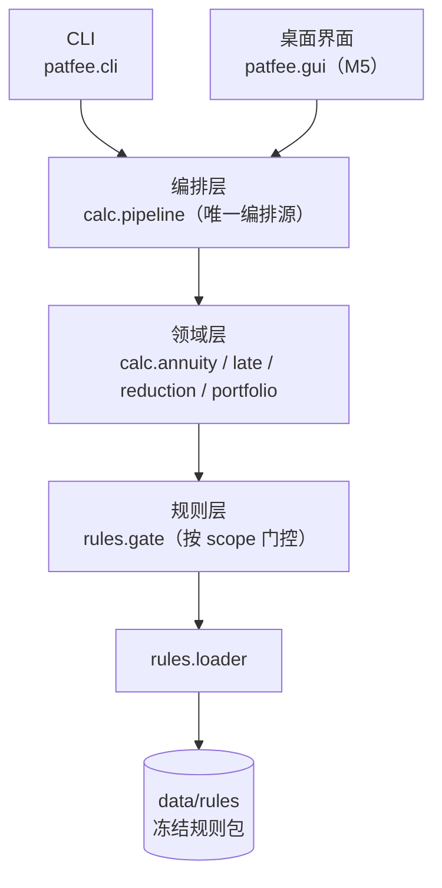

# patent-fee-annuity-calculator

专利年费与费减合规计算工作台 —— 以国家知识产权局**现行专利收费标准表**与**《专利收费减缴办法》财税〔2016〕78 号 + 公告第 316 号 + 公告第 594 号**为规则源，把**年费阶梯计算 + 滞纳金与恢复权利 + 费减资格判定与减免额 + 专利组合批量排期 + 报告导出**做成**逐项挂政策依据、可复现、留指纹**的本地工具（桌面 exe + CLI 双形态）。

> 本地目录 `10-14-patent-fee-annuity-calculator`（`10-14` = 2026-10-14 日期标签）。GitHub 仓库名发布时用纯净名 `patent-fee-annuity-calculator`，见 [plan/00-README总览.md](plan/00-README总览.md)。

**全本地处理、零上传**：专利组合台账含专利权人与代理信息，工具默认不联网、不做任何数据外发。

> **状态：🚧 M0 骨架就绪（2026-10-14），M1（数据逐项复核）待启动。**
> 当前 32 条规则条目**全部为 `status=pending`**（值已挂官方条款坐标，但尚未逐项复核到条目级）——按本项目的门控纪律，**`pending` 条目不得进入计算路径**，故 `calc` 默认返回"未判定"（退出码 1），用 `--preview` 可预览口径。

---

## 它解决什么问题

| 痛点 | 本工具的能力 | 状态 |
|---|---|---|
| 这件专利今年该缴多少年费？ | 按专利类型 × 年度区间阶梯确定性计算，输出所处区间与费率依据 | ✅ 引擎可用（等 M1 数据复核放行） |
| 逾期了滞纳金怎么算？ | 逐月累加（每超期 1 个月加收当年全额年费 5%），跨月可溯 | ⬜ M2 |
| 我够不够格申请费减？减多少？ | 费减资格判定（公告第 316 号阈值）+ 减缴比例（单主体 85% / 共同主体 70%） | ⬜ M2 |
| 同时能享受多项减免时怎么选？ | 多政策择一判定（择最优惠、不得重复享受，依公告第 594 号） | ⬜ M2 |
| 组合几十上百件，哪件快到期？ | 批量排期 + 到期预警清单（按期限升序） | ⬜ M3 |
| 缴费是循环的，"这轮比上轮清了没" | 跨轮对账：新增到期 / 已缴清 / 持续未缴 | ⬜ M3 |
| 结论要能交给内部/客户/存档 | 报告导出（Markdown + XLSX）+ 组合 sha256 指纹 | ⬜ M3/M5 |

## 快速开始（M0 已可跑通）

要求 Python 3.8+（核心功能无第三方依赖）。

```bash
python -m venv .venv
# Windows(Git Bash): source .venv/Scripts/activate    Linux/macOS: source .venv/bin/activate
python -m pip install -U pip
python -m pip install -e ".[dev]"
```

> 注意：Windows 上请用 `python -m pip ...` 而不是 `py -m pip ...` —— `py` 启动器走独立 launcher，**即使已 activate venv 也会装到系统 Python**。

```bash
patfee version                  # 版本 + 规则包坐标
patfee selfcheck                # 数据目录 + 规则加载 + status 门控计数 + 零字面量门禁自检
patfee rules list               # 规则集清单（按 依据文件 × 版本）
patfee rules show fee_schedule  # 逐条查看费率表条目与依据坐标
patfee calc data/samples/patent-demo.json --preview   # 单件年费（预览口径）
patfee bench                    # 内置评测基准
```

**为什么 `calc` 默认不给金额**：规则条目尚未逐项复核。这是本项目的核心纪律，不是缺陷 ——

```console
$ patfee calc data/samples/patent-demo.json
== 年费测算 ==
专利类型: invention
缴费年度: 第 5 年
应缴年费: 未判定
原因码: gated_pending
...
$ echo $?
1

$ patfee calc data/samples/patent-demo.json --preview
应缴年费: 1200.00 元
所处区间: 第 4-6 年
费率依据: 国家知识产权局专利收费标准（专利业务办理系统公示） · 第 4-6 年
提示: 预览口径：条目 annuity.invention 尚未核对（status=pending），金额不得作为缴费依据
$ echo $?
1        # 预览不是达标：退出码仍为 1
```

## 规则库版本化与 status 门控（本项目的核心纪律）

规则库按 **`依据文件 × 版本`** 组织（`data/rules/`），费率与费减规则编码为可执行规则（JSON）。每条挂文号/费率表条款/URL/抓取日期与 `status`：

| status | 含义 | 门控行为 |
|---|---|---|
| `verified` | 已逐项挂原文或官方费率表核对 | **允许进入计算路径** |
| `pending` | 待核对 | **绝不参与任何计算或判定**；`--preview` 可预览但退出码为 1 |
| `input_required` | 本不由规则包承载的外部输入 | 放行门控，但运行时**必须显式索取**，缺失即退出码 2（绝不静默取 0/1） |

**未挂原文核对的条目不得落库生效**。按年度锚定规则版本（2019-07-01 前后、2024-08-06 前后分别适用对应政策）。

### 零政策字面量门禁

费率与阈值只能来自 `data/rules/`。源码里出现政策数值即视为"抄进代码的第二份真相"，由 `rules/literals_gate.py` 扫描拦截（扫描面含 docstring 与注释；生成器除外，它是规则值的唯一来源）：

```console
$ patfee selfcheck | grep 零字面量
零字面量门禁: 扫描 19 文件, 硬门命中 0, 行内放行 0, selftest=通过
```

门禁自带**阳性对照**：`selfcheck` 会把一个禁用 token 写进临时探针文件并断言扫描必须报红 —— 防"门禁全绿其实什么都没查"（token 集为空同样报配置错误）。

## 依据锚点（基准日 2026-10-14 核验）

| 依据 | 编号 | 状态 |
|---|---|---|
| 专利收费减缴办法 | **财税〔2016〕78 号** | ✅ **自 2016-09-01 施行**；✅ 减缴比例 单主体 **85%** / 共同主体 **70%**（原文逐字核对；**非**"个人 85%、企业 70%"） |
| 调整专利收费减缴条件的公告 | **公告第 316 号** | ✅ 2019-06-28 发布、**自 2019-07-01 起**；个人年收入 **4.2 万→6 万**、企业应纳税所得额 **30 万→100 万** |
| 调整部分专利收费标准和减缴政策的公告 | **公告第 594 号** | ✅ 2024-08-06；期限补偿请求费 **200 元/件**、补偿期年费 **8000 元/年**、开放许可年费减免 **15%** |
| 现行专利收费标准表 | 国家知识产权局公示 | ✅ 已直连获取（HTTP 200，41,504 字节；三类专利年费阶梯、滞纳金 5%/月、优先权要求费 80 元等）；**入库时逐项复核** |

> **基准日核验**：截至 2026-10-14 未见新的费率表换版或费减政策替代/作废/延期公告；政策为多文号叠加（2016/2019/2024），历史年度回算需求真实。
> 快照与逐条核对记录见 [data/README.md](data/README.md)。

## 命令行

| 命令 | 说明 | 状态 |
|---|---|---|
| `patfee version` | 版本 + 规则包坐标 | ✅ |
| `patfee selfcheck` | 数据目录 + 规则加载 + 门控计数 + 依赖可用性 + 门禁自检 | ✅ |
| `patfee rules list` / `rules show <id>` | 规则集浏览 | ✅ |
| `patfee calc <专利.json> [--preview] [--json]` | 单件年费测算 | ✅ 引擎就绪（等 M1 数据放行） |
| `patfee bench [--only <套件>]` | 内置评测基准 | ✅ B1；B2–B4 未实装（显式标出，退出码不冒充达标） |
| `patfee rules diff <id>` | 政策差异报告（316 号前后阈值、594 号新增项目） | ⬜ M1 |
| `patfee reduction <主体.json>` | 费减资格与减免额判定 | ⬜ M2 |
| `patfee scan <目录> --out <目录>` | 组合批量排期 + 到期预警 + 对账 + 报告导出 | ⬜ M3 |
| `patfee gui` | 桌面界面 | ⬜ M5 |

### 退出码

| 码 | 含义 |
|---|---|
| `0` | 完成（结论达标） |
| `1` | 降级完成 / 计算非法 —— 门控拒绝、基准未达标、结果带 warning |
| `2` | 输入 / 参数 / 坐标错误 —— 文件不存在、坏 JSON、类型不识别、未知子命令/套件 |
| `3` | 缺可选依赖 —— 源码态缺 extras；冻结态功能未内嵌 |

## 评测基准

| 套件 | 内容 | 状态 |
|---|---|---|
| `b1_ladder` | 年费阶梯边界：区间连续无缝、逐年覆盖唯一、恰好跳档年归新档 | ✅ 99/99 达标（规则驱动） |
| `b2_late` | 滞纳金跨月累加与上限边界 | ⬜ M2 |
| `b3_reduction` | 费减阈值边界（收入/所得额恰好等于阈值、共同主体数 1 与 2） | ⬜ M2 |
| `b4_portfolio` | 合成组合真值全量重算与跨轮对账 | ⬜ M3 |

- **门槛随 `manifest.json` 下发**（数据非代码）：调门槛改数据不改代码；门槛缺失即报配置错误（退出码 2），不回落代码默认值。
- **未实装套件显式标出**：跑 `bench` 会打印"未实装（M2 实装）"，未知名走退出码 2，绝不静默通过。
- **每套件可证伪**：测试里注入缺陷（区间留空洞 / 区间重叠 / 期望篡改）后，套件必须报未达标。

## 技术栈与分层



- **核心层零第三方依赖**（stdlib only），可选件走 extras + 惰性导入：`report`(openpyxl) / `gui`(PySide6) / `build`(PyInstaller)；
- **金额全链路 `Decimal`**（JSON `parse_float=Decimal`），呈现两位小数 `ROUND_HALF_UP`；
- **零 API 依赖**：不使用 LLM，全部结论由确定性规则产生，基准可离线跑；
- 门控**按作用域**分（`calc`/`late`/`reduction`/`check`），一份规则包承载多用途参数时，与本次计算无关的 `pending` 不阻断路径。

## 目录

```
plan/            计划与交接文档（00–06、HANDOFF-M*.md）
data/
  rules/         费率与政策规则包（生成器冻结产物，禁手改）
  knowledge/raw/ 官方原文快照 + sha256 台账
  samples/       README 可复制命令所用的演示输入
src/patfee/      包源码
  rules/         loader / gate / literals / literals_gate（零字面量门禁）
  domain/        模型（PatentType / Decimal 金额 / Tier）
  calc/          annuity（阶梯引擎）/ pipeline（编排层）
  benchmark/     基准套件
tools/           生成器与审计脚本（gen_rulesets / fetch_authorities）
tests/           pytest（104 项）
```

## 开发

```bash
python -m pytest -q                          # 全量测试（112 项）
python tools/gen_rulesets.py --check         # 规则包冻结位级一致 → FROZEN_RULESETS_OK
python tools/fetch_authorities.py --verify   # 原文快照 sha256 复核
python tools/audit_desensitize.py --mode all # 脱敏审计（自检 + 跟踪树 + 历史 + 提交信息）
python tools/audit_desensitize.py --selftest # 只跑审计器的阳性/阴性对照
```

**生成器是 `data/rules/` 的唯一写入者**：产物禁手改；改体例走 `tools/gen_rulesets.py` 整目录重生成，配"再生成逐字节一致"守门测试。

## 里程碑

| 里程碑 | 内容 | 状态 |
|---|---|---|
| M0 | 计划 00–06 定稿 + 可运行骨架（规则加载/门控/阶梯引擎/CLI/基准 B1/测试/CI） | ✅ 完成（2026-10-14） |
| M1 | 数据先行：费率表与政策规则逐项挂原文复核 + 合成专利组合真值库 | ⬜ 待启动 |
| M2 | 计算引擎：滞纳金 + 费减判定 + 多政策择一，算例回归 | ⬜ |
| M3 | 组合排期与对账：批量排期 + 到期预警 + 跨轮对账 + 报告/证据链 | ⬜ |
| M4 | 基准：阶梯边界/滞纳金/费减判定/合成组合四类扫描，指标进 README | ⬜ |
| M5 | 桌面交付：PySide6 界面 + PyInstaller 打包 + 报告导出 + 技术报告 | ⬜ |
| M6 | 脱敏发布 GitHub + Release（exe）+ 收尾固化 | ⬜ |

## 限制与免责

- **首期范围**：现行专利收费标准表（三类专利年费阶梯 + 滞纳金 + 恢复权利/评价报告/期限补偿）+ 费减政策（78 号 + 316 号 + 594 号）；商标/著作权费用留扩展。
- 本工具输出为**基于官方费率表与政策文本的费用测算**，不构成法律或代理意见；正式缴费金额以国家知识产权局规定与缴费通知为准。
- 规则条目核对状态以规则库 `status` 为准；**`pending` 条目不参与计算**。
- 费率表可能逐年调整，规则包每条费率挂该页核对痕迹。
- 演示与基准一律使用**合成专利组合**，不含任何真实专利或申请人信息。
- **已知限制**：年费缴纳期限与滞纳金"月数"口径待 M1 核对《专利法实施细则》后写入规则包（当前 `late.grace_months` / `late.month_basis` 为空 → 走 `missing_value` 拒绝，不会给出猜测值）。

## 许可

MIT，见 [LICENSE](LICENSE)。
