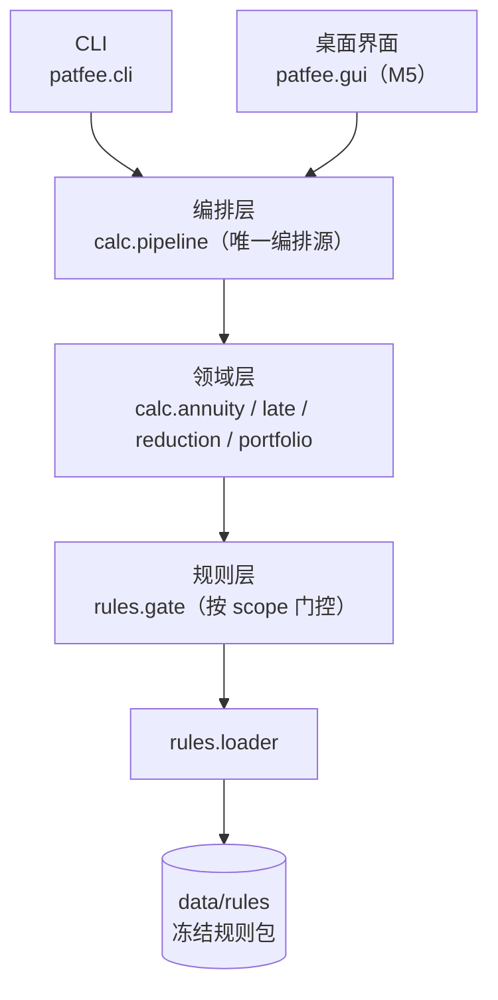

# patent-fee-annuity-calculator

专利年费与费减合规计算工作台 —— 以国家知识产权局**现行专利收费标准表**与**《专利收费减缴办法》财税〔2016〕78 号 + 公告第 316 号 + 公告第 594 号**为规则源，把**年费阶梯计算 + 滞纳金与恢复权利 + 费减资格判定与减免额 + 专利组合批量排期 + 报告导出**做成**逐项挂政策依据、可复现、留指纹**的本地工具（桌面 exe + CLI 双形态）。

> 本地目录 `10-14-patent-fee-annuity-calculator`（`10-14` = 2026-10-14 日期标签）。GitHub 仓库名发布时用纯净名 `patent-fee-annuity-calculator`，见 [plan/00-README总览.md](plan/00-README总览.md)。

**全本地处理、零上传**：专利组合台账含专利权人与代理信息，工具默认不联网、不做任何数据外发。

> **状态：✅ M1 数据先行 + ✅ M2 计算引擎 + ✅ M3 组合排期与对账 + ✅ M4 基准收尾 + ✅ M5 桌面交付（2026-10-14），M6（脱敏发布）待启动。**
> 32 条规则条目已**逐项回到官方原文/费率表页复核，全部 `status=verified`**（复核痕迹在每条 `basis.note`）；《专利法实施细则》（国务院令第 769 号）第 115 条 / 第 5 条已定位，滞纳金 6 个月补缴期与自然月口径落值入库。`calc` 正常计算（退出码 0）；`--preview` 退出码仍为 1（预览不是达标）；M2 新增 `calc --with-late`（滞纳金）与 `patfee reduction`（费减判定）；M3 新增 `patfee scan`（组合批量排期 + 失败隔离 + 到期预警 + 跨轮对账 + 报告落盘）；M4 基准指标固化（B1–B4 达标率与实测耗时进评测基准表，计时门槛 `max_seconds` 随 manifest 下发并实际生效）、探活矩阵补全；M5 新增 `patfee gui`（PySide6 桌面界面，AST 门禁三条锁定零判定逻辑）、`scan --format xlsx`（XLSX 双格式逐字节可复现导出）、`--selftest`（冻结态自检）与 PyInstaller onedir 双 exe 打包、技术报告（plan/技术报告.md）。

---

## 它解决什么问题

| 痛点 | 本工具的能力 | 状态 |
|---|---|---|
| 这件专利今年该缴多少年费？ | 按专利类型 × 年度区间阶梯确定性计算，输出所处区间与费率依据 | ✅ M0/M1 引擎 + 数据放行 |
| 逾期了滞纳金怎么算？ | 逐月累加（每超期 1 个月加收当年全额年费 5%；上限 6 个月、自然月口径，依细则第 115 条核实），跨月可溯 | ✅ M2（`calc --with-late`） |
| 我够不够格申请费减？减多少？ | 费减资格判定（公告第 316 号阈值，**严格低于**才合格）+ 减缴比例（单主体 85% / 共同主体 70%） | ✅ M2（`patfee reduction`） |
| 同时能享受多项减免时怎么选？ | 多政策择一判定（择实缴最小、候选全留痕、不叠加，依公告第 594 号） | ✅ M2 |
| 组合几十上百件，哪件快到期？ | 批量排期 + 到期预警清单（按期限升序），坏件隔离不中断 | ✅ M3（`patfee scan`） |
| 缴费是循环的，"这轮比上轮清了没" | 跨轮对账：新增到期 / 已缴清 / 持续未缴（配对主键 = 专利号；内容变化另立标记） | ✅ M3 |
| 结论要能交给内部/客户/存档 | 报告导出（Markdown + XLSX 双格式，同一渲染源内容对等；XLSX 逐字节可复现）+ 证据 JSON 指纹 | ✅ M5 双格式齐备 |

## 快速开始（M0 已可跑通）

要求 Python 3.8+（核心功能无第三方依赖）。

```bash
python -m venv .venv
# Windows(Git Bash): source .venv/Scripts/activate    Linux/macOS: source .venv/bin/activate
python -m pip install -U pip
python -m pip install -e ".[dev]"
```

> 注意：Windows 上请用 `python -m pip ...` 而不是 `py -m pip ...` —— `py` 启动器走独立 launcher，**即使已 activate venv 也会装到系统 Python**。

```bash
patfee version                  # 版本 + 规则包坐标
patfee selfcheck                # 数据目录 + 规则加载 + status 门控计数 + 零字面量门禁自检
patfee rules list               # 规则集清单（按 依据文件 × 版本）
patfee rules show fee_schedule  # 逐条查看费率表条目与依据坐标
patfee calc data/samples/patent-demo.json --preview   # 单件年费（预览口径）
patfee calc data/samples/patent-late-demo.json --with-late   # 年费 + 滞纳金
patfee reduction data/samples/applicants-demo.json    # 费减资格与减免额判定
patfee scan data/samples/portfolio-demo.json          # 组合批量排期 + 到期预警 + 跨轮对账
patfee scan data/samples/portfolio-demo.json --out 报告目录   # 同上 + 报告落盘（MD + evidence.json）
patfee bench                    # 内置评测基准
patfee gui                      # 桌面界面（PySide6；缺依赖 exit 3 提示安装 extras）
patfee --selftest 自检结果.json  # 冻结态/源码态自检（数据+规则+calc+基准+GUI 冒烟）
```

**`calc` 正常计算、预览仍降级**（M1 后规则已逐项复核；门控与预览语义不随数据状态改变）——

```console
$ patfee calc data/samples/patent-demo.json
== 年费测算 ==
专利类型: invention
缴费年度: 第 5 年
应缴年费: 1200.00 元
所处区间: 第 4-6 年
费率依据: 国家知识产权局专利收费标准（专利业务办理系统公示） · 第 4-6 年
依据坐标: fee_schedule@v2024#annuity.invention
...
$ echo $?
0        # 规则已逐项复核（verified）→ 正常计算

$ patfee calc data/samples/patent-demo.json --preview
应缴年费: 1200.00 元
...
注意: --preview 仅用于预览口径，不得作为缴费依据。
$ echo $?
1        # 预览不是达标：退出码仍为 1（与条目状态无关）
```

**滞纳金扩展**（M2，`calc --with-late`；月数口径与上限从规则包 `late.month_basis` / `late.grace_months` 读，超上限只出 warning 不拦截）——

```console
$ patfee calc data/samples/patent-late-demo.json --with-late
== 年费测算 ==
...
应缴年费: 1200.00 元
...
== 滞纳金测算 ==
...
逾期月数: 2 个月（口径 calendar_month）
滞纳金: 120.00 元
应缴合计（年费+滞纳金）: 1320.00 元
...
$ echo $?
0        # 未超上限 → 正常完成；超上限（第 7 个月起）→ warning，退出码 1
```

**费减判定**（M2，`patfee reduction`；"低于阈值"为**严格小于**，恰好等于不合格；多政策择实缴最小者、不叠加）——

```console
$ patfee reduction data/samples/applicants-demo.json
== 费减资格判定 ==
主体构成: 1 人（单主体）
资格结论: 合格
...
候选政策: 费减（减免比例 0.85 → 实缴 180.00 元）
选中政策: 费减（不叠加，no_double_benefit=choose_most_favorable）
减免后应缴: 180.00 元
$ echo $?
0        # 不合格也是有效结论（退出码 0）；未判定（门控拒绝）才是 1
```

**组合批量排期**（M3，`patfee scan`；失败件隔离单列、不改变退出码——退出码由"是否检出问题"决定；跨轮对账配对主键 = 专利号）——

```console
$ patfee scan data/samples/portfolio-demo.json
== 组合批量排期 ==
基准日: 2026-10-14
件数合计: 7（失败隔离 1）
已缴清: 2 件
已到期未缴清: 2 件
尚未到期: 2 件
失败件（单列，不改变退出码语义）:
  - item[6]: bad_format
未来 3 个月内到期清单（按剩余天数升序）:
  - 990000000005SYN  第 2 年  2026-10-20 到期（还有 6 天）  应缴年费 600.00 元
  ...
== 跨轮对账（配对主键 patent_no）==
新增到期: 990000000004SYN#y3, ...
已缴清: 990000000001SYN#y3, 990000000002SYN#y2
持续未缴: 990000000003SYN#y3
== 未启用章节（没查 ≠ 查了没问题）==
  - 本次组合排期未启用逐件滞纳金测算（对已逾期件用 `patfee calc <件.json> --with-late` 启用）
  ...
$ echo $?
1        # 检出未缴清件 / 窗口内到期件 / 失败件 → 1；全部缴清且无到期 → 0
```

加 `--out <目录>` 落盘 `scan-report.md` + `evidence.json`（含报告 sha256 指纹，可对账防篡改）。

## 规则库版本化与 status 门控（本项目的核心纪律）

规则库按 **`依据文件 × 版本`** 组织（`data/rules/`），费率与费减规则编码为可执行规则（JSON）。每条挂文号/费率表条款/URL/抓取日期与 `status`：

| status | 含义 | 门控行为 |
|---|---|---|
| `verified` | 已逐项挂原文或官方费率表核对 | **允许进入计算路径** |
| `pending` | 待核对 | **绝不参与任何计算或判定**；`--preview` 可预览但退出码为 1 |
| `input_required` | 本不由规则包承载的外部输入 | 放行门控，但运行时**必须显式索取**，缺失即退出码 2（绝不静默取 0/1） |

**未挂原文核对的条目不得落库生效**。按年度锚定规则版本（2019-07-01 前后、2024-08-06 前后分别适用对应政策）。

### 零政策字面量门禁

费率与阈值只能来自 `data/rules/`。源码里出现政策数值即视为"抄进代码的第二份真相"，由 `rules/literals_gate.py` 扫描拦截（扫描面含 docstring 与注释；生成器除外，它是规则值的唯一来源）：

```console
$ patfee selfcheck | grep 零字面量
零字面量门禁: 扫描 31 文件, 硬门命中 0, 行内放行 0, selftest=通过
```

门禁自带**阳性对照**：`selfcheck` 会把一个禁用 token 写进临时探针文件并断言扫描必须报红 —— 防"门禁全绿其实什么都没查"（token 集为空同样报配置错误）。

## 依据锚点（基准日 2026-10-14 核验）

| 依据 | 编号 | 状态 |
|---|---|---|
| 专利收费减缴办法 | **财税〔2016〕78 号** | ✅ **自 2016-09-01 施行**；✅ 减缴比例 单主体 **85%** / 共同主体 **70%**（原文逐字核对；**非**"个人 85%、企业 70%"） |
| 调整专利收费减缴条件的公告 | **公告第 316 号** | ✅ 2019-06-28 发布、**自 2019-07-01 起**；个人年收入 **4.2 万→6 万**、企业应纳税所得额 **30 万→100 万** |
| 调整部分专利收费标准和减缴政策的公告 | **公告第 594 号** | ✅ 2024-08-06；期限补偿请求费 **200 元/件**、补偿期年费 **8000 元/年**、开放许可年费减免 **15%** |
| 现行专利收费标准表 | 国家知识产权局公示 | ✅ 已直连获取（HTTP 200，41,504 字节；三类专利年费阶梯、滞纳金 5%/月、优先权要求费 80 元等）；**M1 已逐项复核 → `verified`** |
| 《中华人民共和国专利法》 | 全国人大常委会（国家法律法规数据库） | ✅ 现行版本 = 2020 年第四次修正（2020-10-17 公布、2021-06-01 施行）；文书级元数据已核，条款级结论未登记（flk 条款接口仅回目录树） |
| 《中华人民共和国专利法实施细则》 | 国务院公报（gov.cn） | ✅ 现行版本 = **国务院令第 769 号**（2023-12-11 公布、2024-01-20 施行）；第 5 条（自然月口径）、第 114/115/116 条（年费缴纳期限、6 个月补缴期、滞纳金 5%/月）已逐字核对入 `data/knowledge/clauses.json` |
| 《专利审查指南》 | 国家知识产权局令（gov.cn 公报） | ✅ 基准版本 = 局令第 78 号（2024-01-20 施行，废止 2010 年版）；现行最新修改 = 局令第 84 号（2026-01-01 施行，与年费/费减口径无关） |

> **基准日核验**：截至 2026-10-14 未见新的费率表换版或费减政策替代/作废/延期公告；政策为多文号叠加（2016/2019/2024），历史年度回算需求真实。
> 快照与逐条核对记录见 [data/README.md](data/README.md)。

## 命令行

| 命令 | 说明 | 状态 |
|---|---|---|
| `patfee version` | 版本 + 规则包坐标 | ✅ |
| `patfee selfcheck` | 数据目录 + 规则加载 + 门控计数 + 依赖可用性 + 门禁自检 | ✅ |
| `patfee rules list` / `rules show <id>` | 规则集浏览 | ✅ |
| `patfee calc <专利.json> [--preview] [--json] [--with-late]` | 单件年费测算（`--with-late` 追加滞纳金） | ✅ M1 数据放行 / M2 滞纳金 |
| `patfee bench [--only <套件>]` | 内置评测基准（达标率 + 失败数 + 计时门槛，随 manifest 下发） | ✅ B1–B4 全实装（M4 收尾固化指标） |
| `patfee rules diff <id>` | 政策差异报告（316 号前后阈值、594 号新增项目与同口径互证） | ✅ M1 实装 |
| `patfee reduction <主体.json>` | 费减资格与减免额判定 | ✅ M2 |
| `patfee scan <组合.json> [--out <目录>] [--format md\|xlsx] [--window-months N]` | 组合批量排期 + 失败隔离 + 到期预警 + 跨轮对账；`--out` 落盘报告（Markdown + XLSX 双格式 + evidence.json 指纹；XLSX 逐字节可复现） | ✅ M3 / M5 XLSX |
| `patfee gui` | 桌面界面（PySide6 多页签：年费/滞纳金、费减、组合排期；只渲染引擎结果，AST 门禁三条锁定零判定逻辑） | ✅ M5 |

### 退出码

| 码 | 含义 |
|---|---|
| `0` | 完成（结论达标） |
| `1` | 降级完成 / 计算非法 —— 门控拒绝、基准未达标、结果带 warning |
| `2` | 输入 / 参数 / 坐标错误 —— 文件不存在、坏 JSON、类型不识别、未知子命令/套件 |
| `3` | 缺可选依赖 —— 源码态缺 extras；冻结态功能未内嵌 |

## 评测基准

`patfee bench` 实测（2026-10-14，py3.12，单次运行；`--json` 输出各套件 `elapsed_seconds`）：

| 套件 | 内容 | 实测结果 | 实测耗时 | manifest 门槛 |
|---|---|---|---|---|
| `b1_ladder` | 年费阶梯边界：区间连续无缝、逐年覆盖唯一、恰好跳档年归新档 | ✅ 99/99 达标率 1.0000（规则驱动） | 0.001s | 达标率 1.0 / 0 失败 / 1.0s |
| `b2_late` | 滞纳金跨月累加与上限边界（真值对账 + 规则驱动端点枚举 + 月数口径零头语义） | ✅ 18/18 达标率 1.0000 | 0.002s | 达标率 1.0 / 0 失败 / 1.0s |
| `b3_reduction` | 费减阈值边界（收入/所得额恰好等于阈值、共同主体数 1 与 2、历史锚点） | ✅ 20/20 达标率 1.0000 | 0.003s | 达标率 1.0 / 0 失败 / 1.0s |
| `b4_portfolio` | 合成组合 18 件真值全量重算（金额锚定冻结真值）+ 失败隔离 + controls 误报对照集 + 跨轮对账口径 | ✅ 48/48 达标率 1.0000 | 0.008s | 达标率 1.0 / 0 失败 / 2.0s |

- **门槛随 `manifest.json` 下发**（数据非代码）：`min_pass_rate` / `max_fail` / `max_seconds` 三项均实际执行——超时判未达标并在判定文案给出原因（M4 起）；门槛缺失即报配置错误（退出码 2），不回落代码默认值。
- **实测耗时进判定**：每套件运行即计时（`CheckResult.elapsed_seconds`，`--json` 可见）；上表数字为实测快照，门槛判定用的是每次运行的实时值。
- **未实装套件显式标出**：`bench --only <套件>` 只跑点名套件且只判定点名套件（不误判未测者）；未知名走退出码 2，绝不静默通过。
- **每套件可证伪（探活矩阵）**：注入缺陷后套件必须报未达标——B1 区间留空洞 / 区间重叠，B2 费率翻倍，B3 阈值抬高，B4 阶梯金额篡改 / 补缴上限抬高打穿 degrade 对照 / 对账漏报 vanished，计时门槛用桩计时注入超时（共 9 条探活测试）。

## 技术栈与分层



- **核心层零第三方依赖**（stdlib only），可选件走 extras + 惰性导入：`report`(openpyxl) / `gui`(PySide6) / `build`(PyInstaller)；
- **金额全链路 `Decimal`**（JSON `parse_float=Decimal`），呈现两位小数 `ROUND_HALF_UP`；
- **零 API 依赖**：不使用 LLM，全部结论由确定性规则产生，基准可离线跑；
- 门控**按作用域**分（`calc`/`late`/`reduction`/`check`），一份规则包承载多用途参数时，与本次计算无关的 `pending` 不阻断路径。

## 目录

```
plan/            计划与交接文档（00–06、HANDOFF-M*.md）
data/
  rules/         费率与政策规则包（生成器冻结产物，禁手改）
  truth/         合成专利组合与真值库（生成器冻结产物，位级可复现）
  knowledge/     上位法依据索引 clauses.json + raw/ 官方原文快照
  samples/       README 可复制命令所用的演示输入
src/patfee/      包源码
  rules/         loader / gate / literals / literals_gate（零字面量门禁）
  domain/        模型（PatentType / Decimal 金额 / Tier / LateResult / ReductionResult）
  calc/          annuity（阶梯）/ late（滞纳金）/ reduction（费减）/ portfolio（组合）/ pipeline（编排层）
  report/        报告层（单一渲染源 Section + Markdown/XLSX 双渲染器，XLSX 可复现）
  gui/           桌面界面（PySide6，只消费 pipeline，AST 门禁三条守门）
  benchmark/     基准套件（B1 阶梯 / B2 滞纳金 / B3 费减 / B4 组合）
packaging/       PyInstaller spec + 入口启动器（onedir 双 exe）
tools/           生成器与审计脚本（gen_rulesets / gen_synthetic / fetch_authorities）
tests/           pytest（M5 后 226 项）
```

## 开发

```bash
python -m pytest -q                          # 全量测试（M5 后 226 项）
python tools/gen_rulesets.py --check         # 规则包冻结位级一致 → FROZEN_RULESETS_OK
python tools/gen_synthetic.py --check        # 合成真值库位级一致 → SYNTHETIC_FROZEN_OK
python tools/fetch_authorities.py --verify   # 原文快照 sha256 复核
python tools/audit_desensitize.py --mode all # 脱敏审计（自检 + 跟踪树 + 历史 + 提交信息）
python tools/audit_desensitize.py --selftest # 只跑审计器的阳性/阴性对照
```

**生成器是 `data/rules/` 的唯一写入者**：产物禁手改；改体例走 `tools/gen_rulesets.py` 整目录重生成，配"再生成逐字节一致"守门测试。

## 里程碑

| 里程碑 | 内容 | 状态 |
|---|---|---|
| M0 | 计划 00–06 定稿 + 可运行骨架（规则加载/门控/阶梯引擎/CLI/基准 B1/测试/CI） | ✅ 完成（2026-10-14） |
| M1 | 数据先行：费率表与政策规则逐项挂原文复核 + 合成专利组合真值库 | ✅ 完成（2026-10-14） |
| M2 | 计算引擎：滞纳金 + 费减判定 + 多政策择一，算例回归 | ✅ 完成（2026-10-14） |
| M3 | 组合排期与对账：批量排期 + 失败隔离 + 到期预警 + 跨轮对账 + 报告落盘 + 基准 B4 | ✅ 完成（2026-10-14） |
| M4 | 基准：阶梯边界/滞纳金/费减判定/合成组合四类扫描，指标进 README | ✅ 完成（2026-10-14，计时门槛实装 + 探活矩阵 9 条 + 指标表固化） |
| M5 | 桌面交付：PySide6 界面 + PyInstaller 打包 + 报告导出 + 技术报告 | ✅ 完成（2026-10-14，AST 门禁三条 + exe --selftest 六项全绿 + 三方对账 + XLSX 可复现） |
| M6 | 脱敏发布 GitHub + Release（exe）+ 收尾固化 | ⬜ |

## 限制与免责

- **首期范围**：现行专利收费标准表（三类专利年费阶梯 + 滞纳金 + 恢复权利/评价报告/期限补偿）+ 费减政策（78 号 + 316 号 + 594 号）；商标/著作权费用留扩展。
- 本工具输出为**基于官方费率表与政策文本的费用测算**，不构成法律或代理意见；正式缴费金额以国家知识产权局规定与缴费通知为准。
- 规则条目核对状态以规则库 `status` 为准；**`pending` 条目不参与计算**。
- 费率表可能逐年调整，规则包每条费率挂该页核对痕迹。
- 演示与基准一律使用**合成专利组合**，不含任何真实专利或申请人信息。
- 滞纳金月数口径已依《专利法实施细则》（国务院令第 769 号）第 5 条 / 第 115 条核定为**自然月**、上限 **6 个月**，随规则包入库（`late.month_basis` / `late.grace_months`），不在代码里写死。

## 许可

MIT，见 [LICENSE](LICENSE)。
