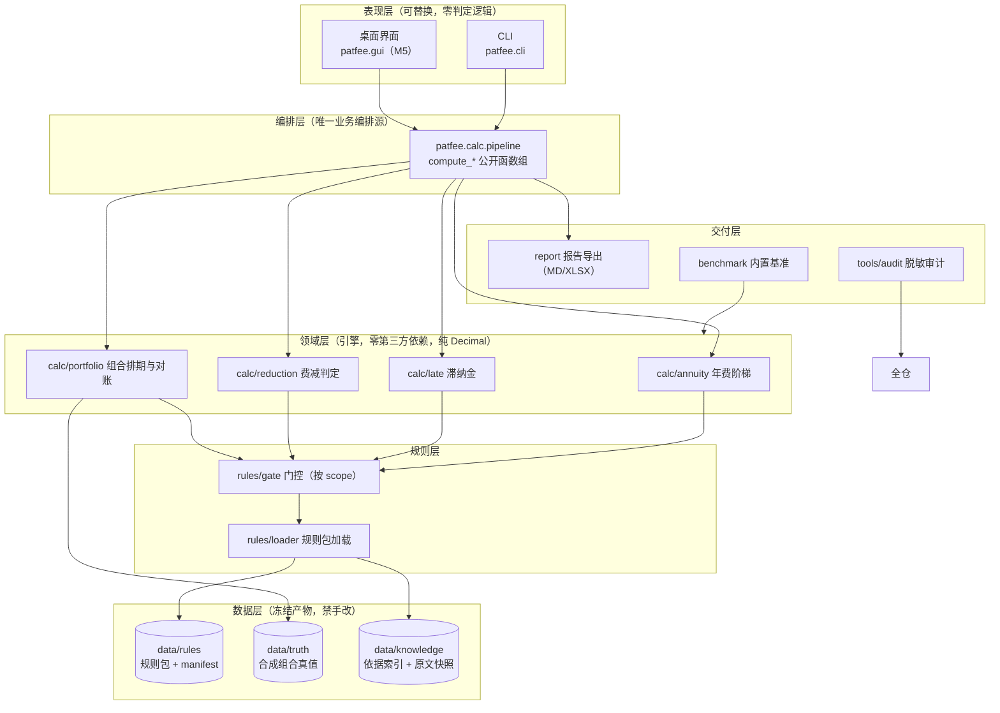

# 03 架构与技术选型

## 一、分层架构



**依赖方向单向向下**：表现层 → 编排层 → 领域层 → 规则层 → 数据层。规则层不认识领域层；领域层不认识 CLI/GUI。GUI 只能经 `pipeline` 取数（M5 用 AST 门禁锁死）。

## 二、目录布局

```
patent-fee-annuity-calculator/
├── plan/                    # 计划与交接文档（00–06、HANDOFF-M*.md）
├── data/                    # 数据（规则包 / 真值 / 依据索引），生成器为唯一写入者
│   ├── rules/               #   费率与政策规则包 + manifest.json
│   ├── truth/               #   合成专利组合与真值库（M1）
│   └── knowledge/           #   依据索引 + 官方原文快照（M1）
├── src/patfee/              # 包源码（唯一包，避免顶层模块遮蔽依赖）
│   ├── cli.py               #   CLI 入口（唯一 main）
│   ├── console.py           #   入口 UTF-8 stdio 守卫 + 打印工具
│   ├── data_paths.py        #   数据目录定位（源码态 / 冻结态分支）
│   ├── errors.py            #   异常与退出码语义
│   ├── rules/               #   loader.py / gate.py
│   ├── domain/              #   models.py（PatentType / 金额 Decimal / 日期工具）
│   ├── calc/                #   annuity.py / late.py / reduction.py / portfolio.py / pipeline.py
│   ├── report/              #   报告渲染（单一渲染源，M3/M5）
│   └── benchmark/           #   基准 runner + 套件
├── tools/                   # 生成器与审计脚本（脚本不是库，import 走 src）
│   ├── gen_rulesets.py      #   规则包生成器（--check 位级一致守门）
│   ├── gen_synthetic.py     #   合成组合生成器（M1）
│   └── audit_desensitize.py #   脱敏审计四步（M6）
├── tests/                   # pytest（含守门测试）
├── .github/workflows/ci.yml # CI 三矩阵
├── pyproject.toml
├── README.md / LICENSE / .gitignore / .gitattributes
```

**包内放 `packaging.py` 之类的辅助模块**（若将来需要），绝不在顶层放与工具链依赖同名的模块（会遮蔽 PyPI 包）。

## 三、技术选型

| 项 | 选型 | 理由 / 否决 |
|---|---|---|
| 语言 | Python ≥ 3.12 | 与系列一致；口径 2026-10-19 自 3.8 上抬（3.8/3.9/3.10 均已 EOL，见 plan/06 D54） |
| 金额类型 | `decimal.Decimal`（全程） | 1 分差异必须可检出；float 尾差不可接受 |
| JSON 解析 | `json.load(..., parse_float=Decimal)` | 防止费率值经 float 失真 |
| CLI | `argparse`（stdlib） | 无第三方依赖；子命令 + `--json` |
| 桌面 | PySide6（extras `gui`） | 系列惯例；底线抬到 3.12 后单条 `>=6.6`（原 3.8 侧的 `<6.7` 上限钉退役） |
| 打包 | PyInstaller onedir（extras `build`） | 免安装；打 GUI 必须 ≥6 |
| XLSX 导出 | `openpyxl`（extras `report`） | 明确为文档化功能，不排除；**同时**自写最小 writer 保字节确定性（M5 定夺） |
| 测试 | pytest（extras `dev`） | 3.8 侧 pytest<9 兼容 |
| CI | GitHub Actions，`{windows,ubuntu}×3.12` | 口径 2026-10-19 随底线抬到 3.12（原 `windows×{3.8,3.12}` + `ubuntu×3.12`，见 plan/06 D54）；另加 `permissions: contents: read` 与 `concurrency` |
| LLM | **不使用** | 纯确定性规则 + 结构化输入，无解析兜底需求 → 零 API 依赖、基准可离线跑 |

## 四、核心层零第三方依赖纪律

- `src/patfee/` 顶层 import 只允许 stdlib。pytest 不足以证明"用户装完就能跑"——CI 另设 **core-only job**（`pip install pytest` + `pip install -e .`，不装 extras）跑核心层守门测试；该 job 必须显式装 pytest（"装 core-only"≠"装齐跑测试所需"）。
- 可选重件（PySide6 / openpyxl / PyInstaller）**只在函数体内 import**，且 `try/except ImportError` 必须包住**从 import 到调用完成**的整段（不是只包 import 行）→ 缺依赖走 `exit 3` 并给提示。
- 提示**按冻结态分流**：源码态说 `pip install -e ".[report]"`；冻结态（exe）说"本发行包未内嵌该功能"（exe 用户装不上 openpyxl）。

## 五、Decimal 计价纪律

1. JSON 加载一律 `parse_float=Decimal`；
2. 引擎内**禁止 float 参与任何金额运算**；字面常量用 `Decimal("0.05")` 形式或直接取规则包值；
3. 呈现/导出统一 `quantize(Decimal("0.01"), ROUND_HALF_UP)`；
4. **量化口径 ≠ 政策数值**：`0.01`、`100`（百分比换算）等属精度约定，豁免零政策字面量门禁，但必须在 `rules/literals.py` 的豁免表里显式登记；
5. GUI 金额输入用文本框 + Decimal 解析（不用浮点控件）。

## 六、数据目录定位（源码态 / 冻结态）

`data_paths.find_data_dir(explicit=None)` 分支优先级（测试锁死，改动属"动了会打挂测试"的口径变更）：

1. 显式参数 / `PATFEE_DATA_DIR` 环境变量；
2. 冻结态：`sys._MEIPASS/data`（PyInstaller 6，onedir 下即 `_internal/data`）；兼容 PyInstaller 5 平铺布局 `<exe目录>/data`；
3. 源码态：`<包根>/../../data`（即仓库 `data/`）；
4. CWD 上溯查找 `data/rules/manifest.json`。

冻结态自检**必须断言数据目录落在 exe 目录内**（`os.path.commonpath([exe_dir, data_dir]) == exe_dir`）——防"exe 回头读开发机仓库"。非冻结态该项返回 `None` 而非 FAIL。

## 七、退出码语义（定稿后锁进 CLI 测试，不得漂移）

| 退出码 | 含义 | 触发例 |
|---|---|---|
| `0` | 完成（结论达标） | `selfcheck` 正常；`bench` 全达标；`calc` 用 verified 规则包算出结果 |
| `1` | **降级完成 / 计算非法** | 门控拒绝（规则 `pending`）；`bench` 未达标；结果带 `warning` |
| `2` | 输入 / 参数 / 坐标错误 | 文件不存在、坏 JSON、类型不识别、未知子命令、未知基准套件名 |
| `3` | 缺可选依赖 | 源码态缺 `openpyxl`/`PySide6`；冻结态功能未内嵌 |

**`--preview`（预览不拦截）**：允许 `pending` 条目参与计算以预览口径，输出必带醒目前缀且**退出码仍为 1**，绝不返回 0 —— 保证 CI/自动化不会把预览当达标。

**批量通路的退出码纪律**：失败件（坏格式/缺字段）记 `scan_error` 等原因码单列，**不改变退出码**；退出码仍由"是否检出问题"决定。"没判定"与"判出问题"是两种语义，不混用。

## 八、CLI 命令面

| 命令 | 里程碑 | 说明 |
|---|---|---|
| `patfee version` | M0 | 版本 + 规则包坐标摘要 |
| `patfee selfcheck` | M0 | 数据目录定位 + 规则包加载 + `status` 门控计数 + 依赖可用性 |
| `patfee rules list` / `patfee rules show <id>` | M0 | 规则集清单与条目（含 status 计数） |
| `patfee rules diff <id>` | M1 | 政策差异报告（316 号前后阈值、594 号新增项目） |
| `patfee calc <专利.json>` | M2 | 单件年费/滞纳金（`--preview` / `--json`） |
| `patfee reduction <主体.json>` | M2 | 费减资格与减免额判定 |
| `patfee scan <目录> --out <目录>` | M3 | 组合批量排期 + 到期预警 + 对账 + 报告导出 |
| `patfee bench [--only <套件>]` | M0 | 内置评测基准 |
| `patfee gui` | M5 | 桌面界面（惰性导入，缺依赖 exit 3） |

M0 实装：`version`/`selfcheck`/`rules list`/`rules show`/`bench`；`calc` 实装阶梯通路（规则包全 `pending` 时按门控拒绝，`--preview` 可预览）；`reduction`/`scan`/`gui` 为**显式占位**（打印所属里程碑后 exit 2），不静默假成功。

## 九、依赖分层（extras）

| extra | 内容 | 说明 |
|---|---|---|
| （无） | 核心：stdlib only | 计算引擎与基准零依赖 |
| `dev` | `pytest>=7,<9`, `pyyaml>=6` | `pyyaml` 用于守门测试解析 CI workflow —— **测试期依赖必须进 dev**，否则 CI 静默少跑 |
| `report` | `openpyxl>=3.0` | XLSX 导出（文档化功能，不排除） |
| `gui` | `PySide6>=6.6`（单条；3.8 侧上限钉随底线上抬退役，见 plan/06 D54） | 桌面界面 |
| `build` | `pyinstaller>=6.0`, `setuptools<81` | 打包；`setuptools<81` 因 PyInstaller 仍 import `pkg_resources`（81 起移除） |

**纪律**：`dev` 的 extras 集合必须覆盖**全部里程碑门的依赖**，否则门在 CI 上静默跳过（"本地一直绿"≠"CI 验过"）。

## 十、原因码（Reason Code）表

引擎不抛裸异常给用户，一律给**原因码 + 人读说明**：

| 原因码 | 含义 | 计入 |
|---|---|---|
| `missing_value` | 规则条目值为 `null`（尚未入库） | 未判定 |
| `gated_pending` | 引用条目 `status=pending`，门控拒绝 | 未判定 |
| `input_required` | 规则包不承载、运行时必须索取的外部输入 | 未判定（运行时索取，缺失 exit 2） |
| `unknown_patent_type` | 专利类型不识别 | 未判定（单个失败件） |
| `bad_format` / `missing_field` | 输入文件坏格式 / 缺必填字段 | 未判定（单个失败件） |
| `out_of_range` | 缴费年度超出阶梯覆盖范围（如发明 > 20 年） | 未判定 + 说明 |
| `late_exceeds_cap` | 逾期月数超过规则包上限（进入失效流程口径） | 风险提示≠判定 |

**"未判定"与"判出问题"是两种结论**：前者留痕不报警，后者才进 `warning`/`fail` 集合。
